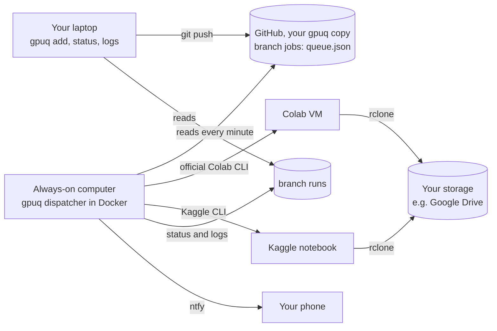

# How it works

## The pieces

- **The queue** is `queue.json` on branch `jobs` of your gpuq copy. `gpuq add` and `gpuq cancel` edit it
  with your usual git credentials. You can also edit it on github.com, from a phone.
- **The dispatcher** runs on the always-on computer, in a container that holds the Colab CLI, the Kaggle
  CLI, rclone and git. It opens no ports. It talks to GitHub, Colab, Kaggle and ntfy, always outwards.
- **Two lanes**, one job at a time on Colab and one on Kaggle, in parallel.
- **Status and logs** go to branch `runs`. `_gpuq/status.json` has the state of every job and lane, and
  `<job>/attempt-NN.log` the end of each attempt's output, with secrets replaced by `***`.
- **Code updates.** The dispatcher runs the default branch of your gpuq copy. When it moves (a new
  `gpuq.toml` or a new gpuq version), the dispatcher exits as soon as no Colab job is running, and Docker
  starts it again on the new code. A Kaggle run keeps going and the new dispatcher keeps following it.

## One attempt on Colab

1. `colab new` asks for a VM (with `--gpu T4` unless the job is CPU only).
2. `colab upload` copies the credentials bundle to the VM. The start script reads it into the
   environment and deletes the file.
3. `colab exec` runs the start script. It installs rclone if needed, checks out your code and this gpuq
   copy, runs the setup command, starts your command **detached from the notebook kernel** and returns.
4. Every minute a short `colab exec` (the poll) brings back the new part of the job's log, free memory,
   free disk, GPU use and, at the end, the exit code.
5. `colab stop` releases the VM.

Why detached. When the connection of a long `colab exec` drops, or its VM dies, the CLI waits forever,
and a job inside that exec has no way to report. A detached job keeps running whatever happens to the
connection, and each poll is a fresh connection, so a dropped connection costs one poll and not the job.
Colab keeps a VM alive through kernel activity and live connections (the CLI's own keep-alive was retired
in September 2026). One short exec a minute was enough for T4 VMs to run for hours in October 2026, and
for 35 minutes of GPU work in a test on 13 November (see Known issues for the days it was not).

When six polls in a row fail, or the CLI says the session was lost, the attempt counts as interrupted
and the job is relaunched on a new VM. Only the CLI's own line (`[colab] Session '...' appears to be lost`
or `... not found`) means the VM is gone. A poll that fails on the network prints a traceback, which can
contain the words "not found" in library source, and counts as one failed poll. Your job has to resume from its checkpoints
([WRITING_JOBS.md](WRITING_JOBS.md)).

## One attempt on Kaggle

1. gpuq builds a private notebook (`<you>/gpuq-launcher`) whose only cell is the same start script, with
   GPU and internet on and the private dataset `<you>/gpuq-credentials` attached.
2. `kaggle kernels push` starts it. Kaggle runs it to the end by itself, up to 12 hours.
3. The dispatcher follows `kaggle kernels status` and reads the log with `kaggle kernels logs`, every 10
   minutes while it runs and once more at the end. The start script works in `/tmp`, because Kaggle keeps
   whatever is left in `/kaggle/working` as the notebook's output.

Kaggle does not hand notebook Secrets to runs started with `kaggle kernels push` (Kaggle CLI issue 582,
still open). The private dataset is the way around it. Keep it private.

## Outcomes and retries

| Outcome | Meaning | What gpuq does |
| --- | --- | --- |
| `done` | your command exited 0 | marks the job done, notifies |
| `job_error` | your command exited with another code | retries until `max_failures` (2), then stops and notifies |
| `setup_error` | checkout or setup failed | same as `job_error` |
| `interrupted` | the machine was lost, the session stopped, a timeout | relaunches up to `max_interruptions` (10) |
| `cancelled` | you ran `gpuq cancel` | stops the VM on Colab. On Kaggle you stop it on kaggle.com |

When Colab gives no GPU, the Colab lane rests 30 minutes and the job goes back to the queue, where Kaggle
can take it. When Kaggle's weekly quota is spent, the Kaggle lane rests 6 hours. Neither counts against
the job.

## Security

- Secrets live in `~/gpuq-data/secrets` on the always-on computer, readable only by your user. They are
  never written to the repo, never printed, and replaced by `***` in everything gpuq publishes.
- The GitHub token travels to git in an HTTP header, never in a URL, a command line or `.git/config`.
- A Colab VM receives the bundle for one attempt and deletes it after reading. On Kaggle it sits in your
  private dataset. Anyone with access to your Kaggle account can read it, so use a fine-grained GitHub
  token limited to your two repositories, and revoke it if you suspect anything.
- With the `drive.file` scope, rclone (and therefore your jobs) can only see the files rclone created,
  not the rest of your Drive.
- The ntfy topic works like a password. gpuq generates a long random one.

## Fair use

Colab and Kaggle are free because their owners allow it, on their terms. gpuq uses the official Colab
CLI, which Google built for running Colab from a terminal and from scripts, and the official Kaggle CLI.
Using them does not change the rules. Read the
[Colab FAQ](https://research.google.com/colaboratory/faq.html), the
[Colab terms](https://research.google.com/colaboratory/tos_v6.html) and the
[Kaggle terms](https://www.kaggle.com/terms). What they say, as of October 2026, that matters here.

- **One account each, your own.** Colab forbids "using multiple accounts to work around access or
  resource usage restrictions" and sharing an account. Kaggle forbids having more than one account.
  Do not run a queue for other people on your accounts. Each person sets up their own.
- **Colab's free tier is meant for interactive work.** "Colab prioritizes interactive compute." On free
  runtimes the FAQ also disallows "remote control such as SSH shells, remote desktops" and "running
  distributed computing workers". gpuq never opens SSH or a console on a VM. It runs one job at a time,
  for you, through the notebook kernel. Whether a given use fits the free tier is your call. If you rely
  on Colab heavily, Colab's paid compute units lift the free-tier restrictions.
- **Kaggle gives about 30 GPU hours a week** and 12 hours per session. gpuq does not try to stretch that.
- **Do not work around limits.** If a platform stops your VMs, find out why rather than finding a way
  past it.

## GitHub Actions

gpuq does not use GitHub Actions to run or to follow jobs. The dispatcher reads and writes the branches
`jobs` and `runs` from the always-on computer. Those branches carry no workflow files, so its pushes
start nothing, and a test keeps it that way.

Your copy has one workflow, the tests in `.github/workflows/ci.yml`. They run on pull requests and on
pushes to `main`, which happen when you change `gpuq.toml` or upgrade gpuq, and take under a minute per
Python version. That matters in a private copy, because a free GitHub account has about 2000 Actions
minutes and 0.5 GB of artifact storage a month, shared by all its private repositories (November 2026).

- **Never commit a workflow to `jobs` or `runs`,** and do not add one that reacts to every push. The
  dispatcher pushes there many times a day.
- **Do not use Actions artifacts for results or checkpoints.** Artifact storage is billed for every hour
  an artifact is kept, 90 days unless the workflow says otherwise, and once the allowance is spent
  GitHub rejects every upload of the account until the next month. In November 2026 a workflow that
  kept 27 MB per run used up a month's storage in 11 days. Results go to your storage remote, and
  small ones to the `runs` branch (see WRITING_JOBS.md).
- **A workflow you add** uploads artifacts only with `retention-days: 1`, runs once per change and has
  a `concurrency` group with `cancel-in-progress` and a `timeout-minutes`.
- If you do not want the tests in your copy, disable Actions for it under **Settings**, **Actions**,
  **General**. gpuq keeps working.

## Known issues

**Colab sometimes reclaims every VM after about 13 minutes.** In October 2026, free Colab VMs without
GPU, driven by the CLI, died 12 to 13.5 minutes after they were assigned, with memory, disk and CPU normal
until the end, while VMs with a T4 GPU ran for more than 4 hours. From 2 November 2026 at 17 UTC to at
least 10 November, VMs with a T4 died the same way: 56 attempts in a row across two queues, none longer
than 22 minutes, with the same CLI and the same design that had run for hours. On 13 November a T4 VM
with gpuq's pattern (detached job, one short poll a minute) ran 35 minutes of GPU work again. Colab does
not publish its limits or say why. Jobs that save every few minutes lose little either way. If attempts
keep ending with `appears to be lost (404/401)` 12 to 15 minutes after they start, send the job to Kaggle
(`--platform kaggle`) rather than spending its interruptions. CPU-only jobs go to Kaggle by default
(`colab.cpu_jobs = false`).

**A container keeps the DNS servers the host had when it started.** If the host's resolver changes
later, for example a VPN such as Tailscale that logs out or a move to another network, the dispatcher
cannot resolve `github.com` any more and no job starts (`Could not resolve host` in `docker logs gpuq`).
After 15 minutes without the queue the dispatcher exits, with the Colab lane empty, and Docker starts
it again with the host's current settings. It repeats that every 15 minutes while the queue stays out
of reach, and after an hour it sends a notification, which also covers an expired GitHub token.
`docker restart gpuq` does the same by hand.

**No CLI cancel on Kaggle.** Kaggle CLI 2.2.4 cannot stop a running notebook. `gpuq cancel` records the
cancellation and the notification links to the page where you click **Cancel run**.

**Numbers differ slightly between platforms.** The same model in FP16 gives results that differ in the
third or fourth decimal between a Colab T4 and Kaggle's two T4s with different CUDA versions. That is why
a job that started on one platform stays there.

## Versions

gpuq was tested with google-colab-cli 0.7.4, kaggle 2.2.4 and rclone 1.75.2, which the Docker image pins.
The jobs run on whatever Python the platform provides (3.12 or 3.13 on Colab in October 2026).
