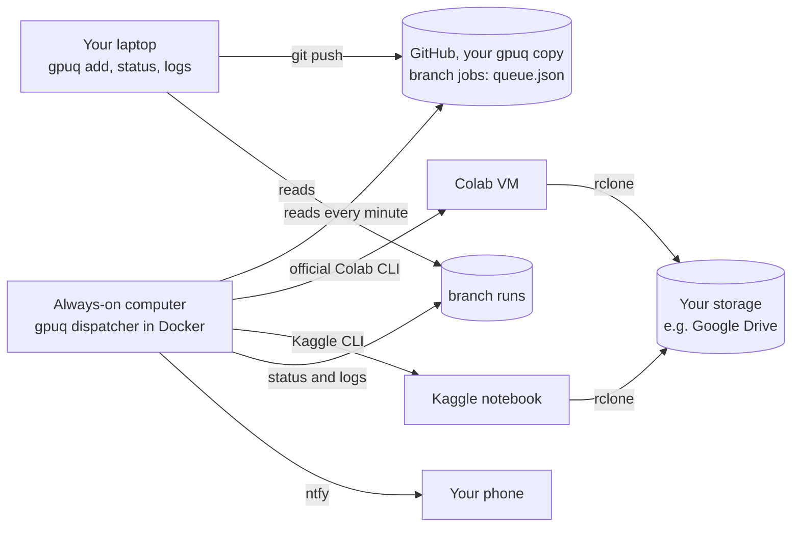

# How it works

## The pieces

- **The queue** is `queue.json` on branch `jobs` of your gpuq copy. `gpuq add` and `gpuq cancel` edit it
  with your usual git credentials. You can also edit it on github.com, from a phone.
- **The dispatcher** runs on the always-on computer, in a container that holds the Colab CLI, the Kaggle
  CLI, rclone and git. It opens no ports. It talks to GitHub, Colab, Kaggle and ntfy, always outwards.
- **Two lanes**, one job at a time on Colab and one on Kaggle, in parallel.
- **Status and logs** go to branch `runs`. `_gpuq/status.json` has the state of every job and lane, and
  `<job>/attempt-NN.log` the end of each attempt's output, with secrets replaced by `***`.
- **Code updates.** The dispatcher runs the default branch of your gpuq copy. When it moves (a new
  `gpuq.toml` or a new gpuq version), the dispatcher exits as soon as no Colab job is running, and Docker
  starts it again on the new code. A Kaggle run keeps going and the new dispatcher keeps following it.

## One attempt on Colab

1. `colab new` asks for a VM (with `--gpu T4` unless the job is CPU only).
2. `colab upload` copies the credentials bundle to the VM. The start script reads it into the
   environment and deletes the file.
3. `colab exec` runs the start script. It installs rclone if needed, checks out your code and this gpuq
   copy, runs the setup command, starts your command **detached from the notebook kernel** and returns.
4. Every minute a short `colab exec` (the poll) brings back the new part of the job's log, free memory,
   free disk, GPU use and, at the end, the exit code.
5. `colab stop` releases the VM.

Why detached. A Colab VM whose only traffic is one long `colab exec` is reclaimed after about 12 minutes,
and the CLI then waits forever. Colab keeps a VM alive through kernel activity and live connections (the
CLI's own keep-alive was retired in September 2026). One short exec a minute gives it both, and each poll
is a fresh connection, so a dropped connection costs one poll and not the job.

When six polls in a row fail, or the CLI says the session was lost, the attempt counts as interrupted
and the job is relaunched on a new VM. Your job has to resume from its checkpoints
([WRITING_JOBS.md](WRITING_JOBS.md)).

## One attempt on Kaggle

1. gpuq builds a private notebook (`<you>/gpuq-launcher`) whose only cell is the same start script, with
   GPU and internet on and the private dataset `<you>/gpuq-credentials` attached.
2. `kaggle kernels push` starts it. Kaggle runs it to the end by itself, up to 12 hours.
3. The dispatcher follows `kaggle kernels status` and, at the end, downloads the log.

Kaggle does not hand notebook Secrets to runs started with `kaggle kernels push` (Kaggle CLI issue 582,
still open). The private dataset is the way around it. Keep it private.

## Outcomes and retries

| Outcome | Meaning | What gpuq does |
| --- | --- | --- |
| `done` | your command exited 0 | marks the job done, notifies |
| `job_error` | your command exited with another code | retries until `max_failures` (2), then stops and notifies |
| `setup_error` | checkout or setup failed | same as `job_error` |
| `interrupted` | the machine was lost, the session stopped, a timeout | relaunches up to `max_interruptions` (10) |
| `cancelled` | you ran `gpuq cancel` | stops the VM on Colab. On Kaggle you stop it on kaggle.com |

When Colab gives no GPU, the Colab lane rests 30 minutes and the job goes back to the queue, where Kaggle
can take it. When Kaggle's weekly quota is spent, the Kaggle lane rests 6 hours. Neither counts against
the job.

## Security

- Secrets live in `~/gpuq-data/secrets` on the always-on computer, readable only by your user. They are
  never written to the repo, never printed, and replaced by `***` in everything gpuq publishes.
- The GitHub token travels to git in an HTTP header, never in a URL, a command line or `.git/config`.
- A Colab VM receives the bundle for one attempt and deletes it after reading. On Kaggle it sits in your
  private dataset. Anyone with access to your Kaggle account can read it, so use a fine-grained GitHub
  token limited to your two repositories, and revoke it if you suspect anything.
- With the `drive.file` scope, rclone (and therefore your jobs) can only see the files rclone created,
  not the rest of your Drive.
- The ntfy topic works like a password. gpuq generates a long random one.

## Fair use

Colab and Kaggle are free because their owners allow it, on their terms. gpuq uses the official Colab
CLI, which Google built for running Colab from a terminal and from scripts, and the official Kaggle CLI.
Using them does not change the rules. Read the
[Colab FAQ](https://research.google.com/colaboratory/faq.html), the
[Colab terms](https://research.google.com/colaboratory/tos_v6.html) and the
[Kaggle terms](https://www.kaggle.com/terms). What they say, as of October 2026, that matters here.

- **One account each, your own.** Colab forbids "using multiple accounts to work around access or
  resource usage restrictions" and sharing an account. Kaggle forbids having more than one account.
  Do not run a queue for other people on your accounts. Each person sets up their own.
- **Colab's free tier is meant for interactive work.** "Colab prioritizes interactive compute." On free
  runtimes the FAQ also disallows "remote control such as SSH shells, remote desktops" and "running
  distributed computing workers". gpuq never opens SSH or a console on a VM. It runs one job at a time,
  for you, through the notebook kernel. Whether a given use fits the free tier is your call. If you rely
  on Colab heavily, Colab's paid compute units lift the free-tier restrictions.
- **Kaggle gives about 30 GPU hours a week** and 12 hours per session. gpuq does not try to stretch that.
- **Do not work around limits.** If a platform stops your VMs, find out why rather than finding a way
  past it.

## Known issues

**Colab CPU VMs die when they start a large upload.** On 20 October 2026 a free Colab VM without GPU
died between 40 and 70 seconds after rclone started uploading a 2.8 GB file to Google Drive at about
33 MB/s. Memory, disk and CPU were normal until the end. The same had happened in earlier runs. Whether
VMs with a GPU behave the same is being checked. Colab does not publish the reason. Until it is clear,
CPU-only jobs go to Kaggle by default (`colab.cpu_jobs = false`), and jobs that upload several GB at once
are better sent to Kaggle (`--platform kaggle`). Regular checkpoints of moderate size have caused no
trouble.

**Colab VMs arrive warm.** A VM can have been running for about 11 minutes before it is assigned to you.
Its limits, whatever they are, may count from boot and not from assignment.

**No CLI cancel on Kaggle.** Kaggle CLI 2.2.4 cannot stop a running notebook. `gpuq cancel` records the
cancellation and the notification links to the page where you click **Cancel run**.

**Numbers differ slightly between platforms.** The same model in FP16 gives results that differ in the
third or fourth decimal between a Colab T4 and Kaggle's two T4s with different CUDA versions. That is why
a job that started on one platform stays there.

**Logs on Kaggle arrive at the end.** While a Kaggle job runs, gpuq asks for its log every 10 minutes,
but Kaggle does not always return it before the run ends.

## Versions

gpuq was tested with google-colab-cli 0.7.4, kaggle 2.2.4 and rclone 1.75.2, which the Docker image pins.
The jobs run on whatever Python the platform provides (3.12 or 3.13 on Colab in October 2026).
